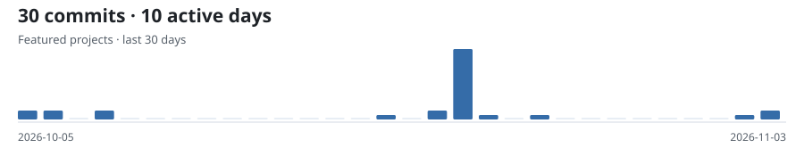

<!-- Generated from config/profile.json and public project activity. -->
<picture><source media="(max-width: 600px) and (prefers-reduced-motion: reduce) and (prefers-color-scheme: dark)" srcset="assets/profile/generated/identity-mobile-dark.png"><source media="(max-width: 600px) and (prefers-reduced-motion: reduce)" srcset="assets/profile/generated/identity-mobile-light.png"><source media="(prefers-reduced-motion: reduce) and (prefers-color-scheme: dark)" srcset="assets/profile/generated/identity-dark.png"><source media="(prefers-reduced-motion: reduce)" srcset="assets/profile/generated/identity-light.png"><source media="(max-width: 600px) and (prefers-color-scheme: dark)" srcset="assets/profile/generated/identity-mobile-dark.svg"><source media="(max-width: 600px)" srcset="assets/profile/generated/identity-mobile-light.svg"><source media="(prefers-color-scheme: dark)" srcset="assets/profile/generated/identity-dark.svg"></picture>

I build backend services and full-stack applications.

[GitHub](https://github.com/slavisa-simic) · [LinkedIn](https://www.linkedin.com/in/slavi%C5%A1a-simi%C4%87-1879bb438/)

## Projects carousel

<a href="#projects-list"><picture><source media="(max-width: 600px) and (prefers-reduced-motion: reduce)" srcset="assets/profile/generated/projects-carousel-mobile.png"><source media="(prefers-reduced-motion: reduce)" srcset="assets/profile/generated/projects-carousel.png"><source media="(max-width: 600px)" srcset="assets/profile/generated/projects-carousel-mobile.svg"></picture></a>

### Projects list

<a href="https://github.com/slavisa-simic/vigil/blob/main/README.md"><strong>Vigil</strong></a> — Incident management, from report to resolution.

Stack &amp; architecture

Java / Spring Boot API, PostgreSQL, React / TypeScript client, and Docker Compose. JWT authentication and role-based access control protect the incident workflow.

<a href="https://github.com/slavisa-simic/tower-defense-ai/blob/main/README.md"><strong>Potamorph</strong></a> — AI-assisted development, from a brief to a working prototype.

Behind the build

I set the direction and scope; Codex handled implementation and tooling. The resulting prototype, currently titled Border Defenders, uses Unity and C#. The repository retains phase briefs and validation reports.

## Toolkit

**Backend:** Java · Spring Boot · PostgreSQL · REST APIs · Authentication · Docker **AI Development Tools:** OpenAI Codex

## Recent work

<picture><source media="(max-width: 600px) and (prefers-color-scheme: dark)" srcset="assets/profile/generated/activity-mobile-dark.svg"><source media="(max-width: 600px)" srcset="assets/profile/generated/activity-mobile-light.svg"><source media="(prefers-color-scheme: dark)" srcset="assets/profile/generated/activity-dark.svg"></picture>

- [fix(balance): close late economy and Industrial Port pressure](https://github.com/slavisa-simic/tower-defense-ai/commit/715548fccbd02a156cc8f6ab12160b1adc938e74) Potamorph · 2026-11-03
- [feat(gameplay): add contextual onboarding and Phase 6E balance pass](https://github.com/slavisa-simic/tower-defense-ai/commit/2bbce1721f3b3d10fd3b304782855f1b678e75a6) Potamorph · 2026-11-03
- [feat: add aquatic assaults, navigation combat, and research progression](https://github.com/slavisa-simic/tower-defense-ai/commit/453992c3a86fdbab0ab77355d09aa6f6a6e7aa77) Potamorph · 2026-11-02

Featured repositories only · Snapshot 2026-11-03 18:50:54 UTC
