<!-- Generated from config/profile.json and config/tech-stack.json. -->

<picture><source media="(max-width: 960px) and (prefers-color-scheme: light)" srcset="assets/profile/generated/profile-header-560e207591a807ae-mobile-light.svg"><source media="(max-width: 960px)" srcset="assets/profile/generated/profile-header-560e207591a807ae-mobile.svg"><source media="(prefers-color-scheme: light)" srcset="assets/profile/generated/profile-header-560e207591a807ae-light.svg"></picture>

<picture><source media="(max-width: 960px) and (prefers-color-scheme: light)" srcset="assets/profile/generated/header-spacer-mobile-light.svg"><source media="(max-width: 960px)" srcset="assets/profile/generated/header-spacer-mobile.svg"><source media="(prefers-color-scheme: light)" srcset="assets/profile/generated/header-spacer-light.svg"></picture><a href="https://github.com/slavisa-simic?tab=repositories"><picture><source media="(prefers-color-scheme: light)" srcset="assets/profile/generated/link-github-light.svg"></picture></a> <a href="https://www.linkedin.com/in/slavi%C5%A1a-simi%C4%87-1879bb438/"><picture><source media="(prefers-color-scheme: light)" srcset="assets/profile/generated/link-linkedin-light.svg"></picture></a>

<picture><source media="(max-width: 600px) and (prefers-color-scheme: light)" srcset="assets/profile/generated/about-me-animated-mobile-light.svg"><source media="(max-width: 600px)" srcset="assets/profile/generated/about-me-animated-mobile.svg"><source media="(prefers-color-scheme: light)" srcset="assets/profile/generated/about-me-animated-light.svg">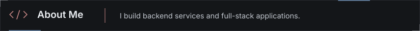</picture>

<picture><source media="(max-width: 600px)" srcset="assets/profile/generated/title-projects-animated-mobile.svg"></picture>

<a href="#projects-list"><picture><source media="(max-width: 600px) and (prefers-reduced-motion: reduce)" srcset="assets/profile/generated/projects-carousel-mobile-reduced.svg"><source media="(prefers-reduced-motion: reduce)" srcset="assets/profile/generated/projects-carousel-reduced.svg"><source media="(max-width: 600px)" srcset="assets/profile/generated/projects-carousel-mobile.svg"></picture></a>

<table width="100%"><tbody><tr><td width="25%" align="center" valign="middle">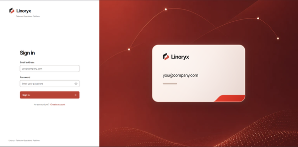</td><td width="35%" align="center" valign="middle">
<strong>Linoryx</strong>

Telecom operations platform

A full-stack platform for managing telecom services, customer reports, incidents and technician workflows, with role-based access and audit logging.
</td><td width="22%" align="center" valign="middle">
<strong>Tech stack</strong>

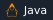  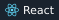 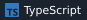  
</td><td width="18%" align="center" valign="middle">
<a href="https://github.com/slavisa-simic/linoryx"><picture><source media="(prefers-color-scheme: light)" srcset="assets/profile/generated/project-repository-light.svg"></picture></a>

<picture><source media="(prefers-color-scheme: light)" srcset="assets/profile/generated/project-demo-light.svg"></picture>
</td></tr><tr><td width="25%" align="center" valign="middle">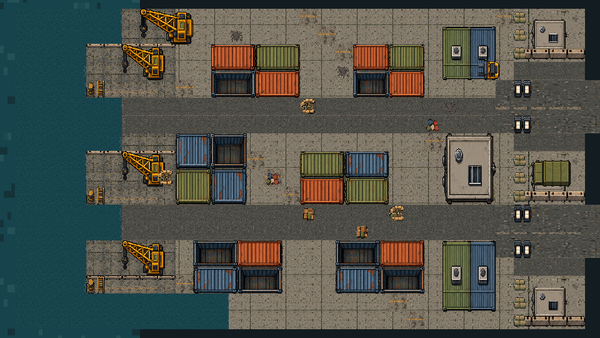</td><td width="35%" align="center" valign="middle">
<strong>Potamorph</strong>

Tower-defense game

A tower-defense prototype set on the Danube, with aquatic enemies, defense upgrades, and two maps.
</td><td width="22%" align="center" valign="middle">
<strong>Tech stack</strong>

 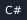 

Built with OpenAI Codex
</td><td width="18%" align="center" valign="middle">
<a href="https://github.com/slavisa-simic/tower-defense-ai"><picture><source media="(prefers-color-scheme: light)" srcset="assets/profile/generated/project-repository-light.svg"></picture></a>

<picture><source media="(prefers-color-scheme: light)" srcset="assets/profile/generated/project-demo-light.svg"></picture>
</td></tr></tbody></table>

<!-- commit-activity:start -->

<picture><source media="(max-width: 600px)" srcset="assets/profile/generated/title-github-activity-animated-mobile.svg"></picture>

<picture><source media="(max-width: 600px)" srcset="assets/profile/generated/activity-commits-mobile.gif">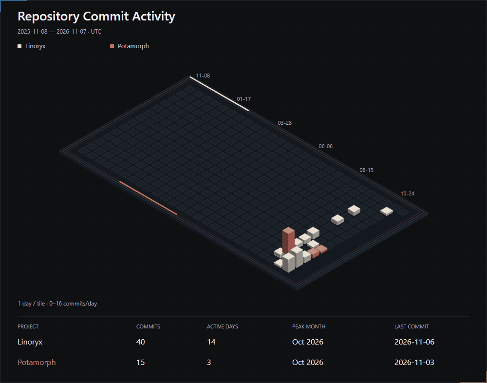</picture>

<a href="https://github.com/slavisa-simic/linoryx">Linoryx</a> · <a href="https://github.com/slavisa-simic/tower-defense-ai">Potamorph</a>

<!-- commit-activity:end -->
