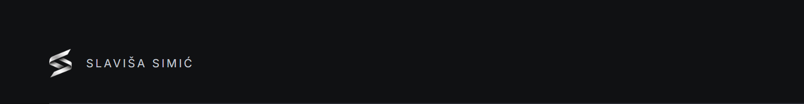
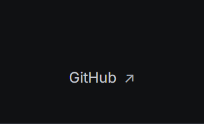
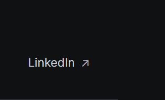
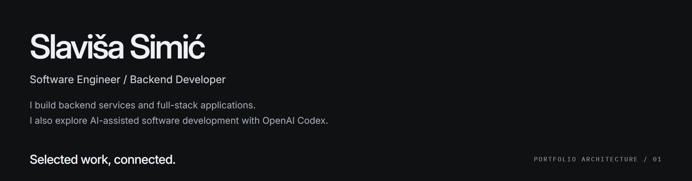
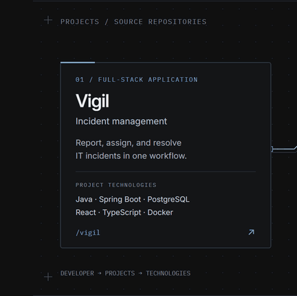
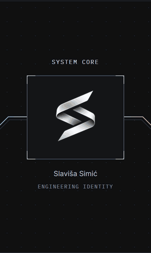
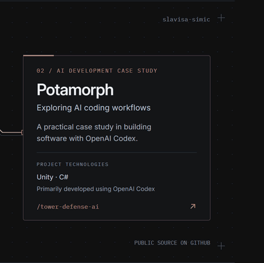
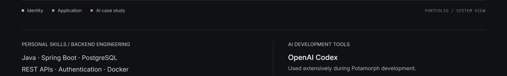
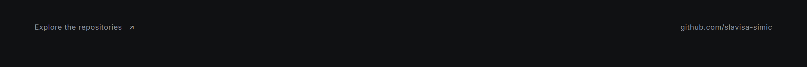
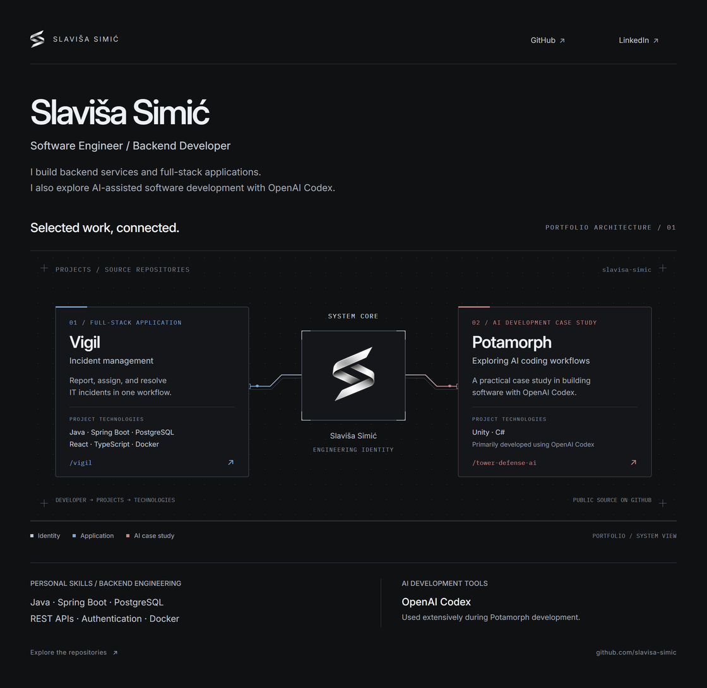

<!-- Generated from config/network.json, src/blueprint.*, and src/README.template.md. -->

<a href="https://github.com/slavisa-simic"><picture><source media="(max-width: 600px)" srcset="assets/blueprint/mobile/brand.png"></picture></a><a href="https://github.com/slavisa-simic"><picture><source media="(max-width: 600px)" srcset="assets/blueprint/mobile/github.png"></picture></a><a href="https://www.linkedin.com/in/slavi%C5%A1a-simi%C4%87-1879bb438/"><picture><source media="(max-width: 600px)" srcset="assets/blueprint/mobile/linkedin.png"></picture></a> <picture><source media="(max-width: 600px)" srcset="assets/blueprint/mobile/identity.png"></picture> <a href="https://github.com/slavisa-simic/vigil"><picture><source media="(max-width: 600px) and (prefers-reduced-motion: reduce)" srcset="assets/blueprint/mobile/vigil.png"><source media="(max-width: 600px)" srcset="assets/blueprint/mobile/vigil.gif"><source media="(prefers-reduced-motion: reduce)" srcset="assets/blueprint/desktop/vigil.png"></picture></a><a href="https://github.com/slavisa-simic"><picture><source media="(max-width: 600px) and (prefers-reduced-motion: reduce)" srcset="assets/blueprint/mobile/core.png"><source media="(max-width: 600px)" srcset="assets/blueprint/mobile/core.gif"><source media="(prefers-reduced-motion: reduce)" srcset="assets/blueprint/desktop/core.png"></picture></a><a href="https://github.com/slavisa-simic/tower-defense-ai"><picture><source media="(max-width: 600px) and (prefers-reduced-motion: reduce)" srcset="assets/blueprint/mobile/potamorph.png"><source media="(max-width: 600px)" srcset="assets/blueprint/mobile/potamorph.gif"><source media="(prefers-reduced-motion: reduce)" srcset="assets/blueprint/desktop/potamorph.png"></picture></a> <picture><source media="(max-width: 600px)" srcset="assets/blueprint/mobile/practice.png"></picture> <a href="https://github.com/slavisa-simic?tab=repositories"><picture><source media="(max-width: 600px)" srcset="assets/blueprint/mobile/footer.png"></picture></a>

## Featured work

### [Vigil — incident management](https://github.com/slavisa-simic/vigil)

A full-stack application for reporting, assigning, and resolving IT incidents. JWT authentication and role-based access control protect the workflow; PostgreSQL stores incidents, comments, and audit records.

**Project technologies:** Java, Spring Boot, PostgreSQL, React, TypeScript, Docker.

[Explore Vigil →](https://github.com/slavisa-simic/vigil)

### [Potamorph — AI development case study](https://github.com/slavisa-simic/tower-defense-ai)

My practical exploration of building software with **OpenAI Codex**. I set the project direction and scope, and used Codex extensively for implementation, tooling, and validation. The repository includes phase briefs, development reports, and validation evidence.

The resulting project is a military tower-defense prototype, currently titled **Border Defenders** in the repository. **Unity and C# are the prototype's technologies.** This case study focuses on my use of AI development tools.

[Explore the case study →](https://github.com/slavisa-simic/tower-defense-ai#built-with-codex)

## Personal skills

Java · Spring Boot · PostgreSQL · REST APIs · Authentication · Docker

## AI Development Tools

**OpenAI Codex** — used extensively during Potamorph development, from scoped project briefs through implementation and validation.

## GitHub activity

[Profile contributions](https://github.com/slavisa-simic#overview) · [Vigil development](https://github.com/slavisa-simic/vigil/commits/main/) · [Potamorph development](https://github.com/slavisa-simic/tower-defense-ai/commits/main/)

Static network and accessible profile overview

**Slaviša Simić — Software Engineer / Backend Developer.** I build backend services and full-stack applications. I also explore AI-assisted software development with OpenAI Codex.

The portfolio diagram connects my personal System Core to Vigil, a full-stack incident-management application, and Potamorph, an AI development case study.

<picture><source media="(max-width: 600px)" srcset="assets/blueprint/mobile/hero-static.png"></picture>

The static view remains complete without animation. The linked animated panels use one timeline, but GitHub may start their playback at different times. Their connection geometry stays fixed.

---

[GitHub](https://github.com/slavisa-simic) · [LinkedIn](https://www.linkedin.com/in/slavi%C5%A1a-simi%C4%87-1879bb438/) · [Repositories](https://github.com/slavisa-simic?tab=repositories)
