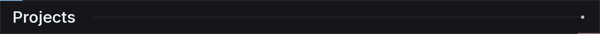
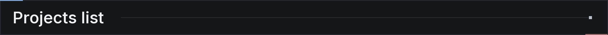

<!-- Generated from config/profile.json, config/tech-stack.json and public project activity. -->

<picture><source media="(max-width: 768px) and (prefers-color-scheme: light)" srcset="assets/profile/generated/profile-header-7986974f63d5a9f1-mobile-light.svg"><source media="(max-width: 768px)" srcset="assets/profile/generated/profile-header-7986974f63d5a9f1-mobile.svg"><source media="(prefers-color-scheme: light)" srcset="assets/profile/generated/profile-header-7986974f63d5a9f1-light.svg"></picture>

<picture><source media="(max-width: 768px) and (prefers-color-scheme: light)" srcset="assets/profile/generated/header-spacer-mobile-light.svg"><source media="(max-width: 768px)" srcset="assets/profile/generated/header-spacer-mobile.svg"><source media="(prefers-color-scheme: light)" srcset="assets/profile/generated/header-spacer-light.svg"></picture><a href="https://github.com/slavisa-simic?tab=repositories"><picture><source media="(prefers-color-scheme: light)" srcset="assets/profile/generated/link-github-light.svg"></picture></a> <a href="https://www.linkedin.com/in/slavi%C5%A1a-simi%C4%87-1879bb438/"><picture><source media="(prefers-color-scheme: light)" srcset="assets/profile/generated/link-linkedin-light.svg"></picture></a>

<picture><source media="(max-width: 600px)" srcset="assets/profile/generated/title-projects-mobile.png"></picture>

<a href="#projects-list"><picture><source media="(max-width: 600px) and (prefers-reduced-motion: reduce)" srcset="assets/profile/generated/projects-carousel-mobile-reduced.svg"><source media="(prefers-reduced-motion: reduce)" srcset="assets/profile/generated/projects-carousel-reduced.svg"><source media="(max-width: 600px)" srcset="assets/profile/generated/projects-carousel-mobile.svg"></picture></a>

<h3><picture><source media="(max-width: 600px)" srcset="assets/profile/generated/title-projects-list-mobile.png"></picture></h3>

<table><thead><tr><th>Project</th><th>Commits 30 days</th><th>Stars</th></tr></thead><tbody><tr><td><a href="https://github.com/slavisa-simic/vigil/blob/main/README.md"><samp>Vigil</samp></a></td><td align="center"><samp>15</samp></td><td align="center"><samp>0</samp></td></tr><tr><td><a href="https://github.com/slavisa-simic/tower-defense-ai/blob/main/README.md"><samp>Potamorph</samp></a></td><td align="center"><samp>15</samp></td><td align="center"><samp>0</samp></td></tr></tbody></table>

GitHub API · hourly sync · last success 03 Nov 2026, 23:19:08 UTC

<picture><source media="(max-width: 600px)" srcset="assets/profile/generated/title-project-notes.png"></picture>

<strong>Vigil</strong> Java / Spring Boot API, PostgreSQL, React / TypeScript client, and Docker Compose. JWT authentication and role-based access control protect the incident workflow.

<strong>Potamorph</strong> I set the direction and scope; Codex handled implementation and tooling. The resulting prototype, currently titled Border Defenders, uses Unity and C#. The repository retains phase briefs and validation reports.

<a href="assets/profile/generated/projects-carousel.png">Static project preview</a>

<picture><source media="(max-width: 600px)" srcset="assets/profile/generated/title-recent-changes.png"></picture>

- [fix(balance): close late economy and Industrial Port pressure](https://github.com/slavisa-simic/tower-defense-ai/commit/715548fccbd02a156cc8f6ab12160b1adc938e74) Potamorph · 2026-11-03
- [feat(gameplay): add contextual onboarding and Phase 6E balance pass](https://github.com/slavisa-simic/tower-defense-ai/commit/2bbce1721f3b3d10fd3b304782855f1b678e75a6) Potamorph · 2026-11-03
- [feat: add aquatic assaults, navigation combat, and research progression](https://github.com/slavisa-simic/tower-defense-ai/commit/453992c3a86fdbab0ab77355d09aa6f6a6e7aa77) Potamorph · 2026-11-02

