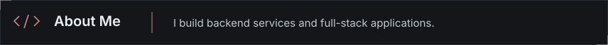
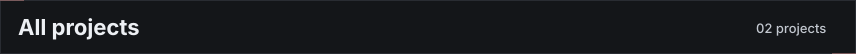
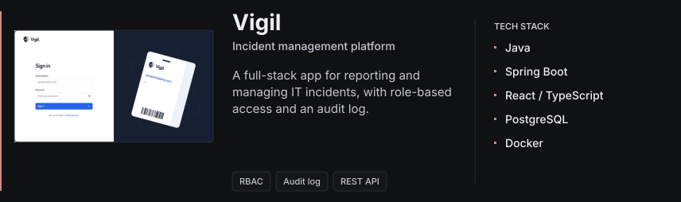
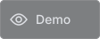
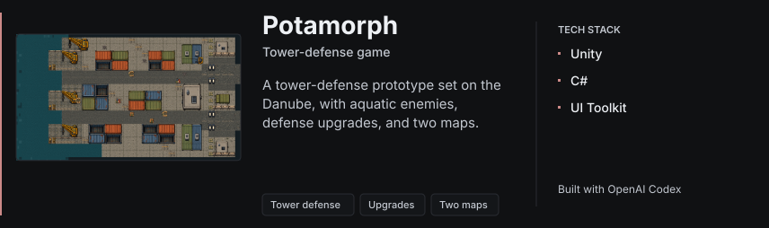

<!-- Generated from config/profile.json and config/tech-stack.json. -->

<picture><source media="(max-width: 960px) and (prefers-color-scheme: light)" srcset="assets/profile/generated/profile-header-bba72afce17fb284-mobile-light.svg"><source media="(max-width: 960px)" srcset="assets/profile/generated/profile-header-bba72afce17fb284-mobile.svg"><source media="(prefers-color-scheme: light)" srcset="assets/profile/generated/profile-header-bba72afce17fb284-light.svg"></picture>

<picture><source media="(max-width: 960px) and (prefers-color-scheme: light)" srcset="assets/profile/generated/header-spacer-mobile-light.svg"><source media="(max-width: 960px)" srcset="assets/profile/generated/header-spacer-mobile.svg"><source media="(prefers-color-scheme: light)" srcset="assets/profile/generated/header-spacer-light.svg"></picture><a href="https://github.com/slavisa-simic?tab=repositories"><picture><source media="(prefers-color-scheme: light)" srcset="assets/profile/generated/link-github-light.svg"></picture></a> <a href="https://www.linkedin.com/in/slavi%C5%A1a-simi%C4%87-1879bb438/"><picture><source media="(prefers-color-scheme: light)" srcset="assets/profile/generated/link-linkedin-light.svg"></picture></a>

<picture><source media="(max-width: 600px) and (prefers-color-scheme: light)" srcset="assets/profile/generated/about-me-mobile-light.svg"><source media="(max-width: 600px)" srcset="assets/profile/generated/about-me-mobile.svg"><source media="(prefers-color-scheme: light)" srcset="assets/profile/generated/about-me-light.svg"></picture>

<picture><source media="(max-width: 600px)" srcset="assets/profile/generated/title-projects-mobile.png"></picture>

<a href="#projects-list"><picture><source media="(max-width: 600px) and (prefers-reduced-motion: reduce)" srcset="assets/profile/generated/projects-carousel-mobile-reduced.svg"><source media="(prefers-reduced-motion: reduce)" srcset="assets/profile/generated/projects-carousel-reduced.svg"><source media="(max-width: 600px)" srcset="assets/profile/generated/projects-carousel-mobile.svg"></picture></a>

<picture><source media="(max-width: 768px) and (prefers-color-scheme: light)" srcset="assets/profile/generated/project-table-title-mobile-light.svg"><source media="(max-width: 768px)" srcset="assets/profile/generated/project-table-title-mobile.svg"><source media="(prefers-color-scheme: light)" srcset="assets/profile/generated/project-table-title-light.svg"></picture>

<table width="100%"><tbody><tr><td width="10000"><picture><source media="(max-width: 768px) and (prefers-color-scheme: light)" srcset="assets/profile/generated/project-vigil-mobile-light.svg"><source media="(max-width: 768px)" srcset="assets/profile/generated/project-vigil-mobile.svg"><source media="(prefers-color-scheme: light)" srcset="assets/profile/generated/project-vigil-light.svg"></picture>
<a href="https://github.com/slavisa-simic/vigil"><picture><source media="(prefers-color-scheme: light)" srcset="assets/profile/generated/project-repository-light.svg"></picture></a> <picture><source media="(prefers-color-scheme: light)" srcset="assets/profile/generated/project-demo-light.svg"></picture>
</td></tr><tr><td width="10000"><picture><source media="(max-width: 768px) and (prefers-color-scheme: light)" srcset="assets/profile/generated/project-potamorph-mobile-light.svg"><source media="(max-width: 768px)" srcset="assets/profile/generated/project-potamorph-mobile.svg"><source media="(prefers-color-scheme: light)" srcset="assets/profile/generated/project-potamorph-light.svg"></picture>
<a href="https://github.com/slavisa-simic/tower-defense-ai"><picture><source media="(prefers-color-scheme: light)" srcset="assets/profile/generated/project-repository-light.svg"></picture></a> <picture><source media="(prefers-color-scheme: light)" srcset="assets/profile/generated/project-demo-light.svg"></picture>
</td></tr></tbody></table>
